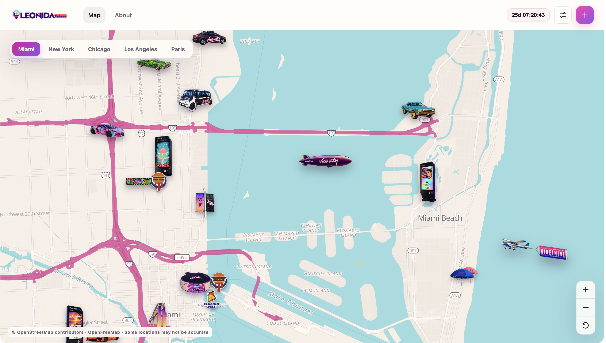

# Leonida Marketing



With new things coming up every day, I decided to create this project to help the community track everything that’s happening in the real world around GTA VI marketing.

A responsive, map-focused React app for cataloguing real-world GTA VI marketing sightings. It uses MapLibre GL JS with OpenFreeMap vector tiles, OpenStreetMap data, static JSON content, and no backend.

[Website](leonida-market.ing)

## Run locally

```bash
npm install
npm run dev
```

Build and preview the static production output:

```bash
npm run build
npm run preview
```

## Content and configuration

- Add or edit sightings in `src/data/actions.source.yaml`. A physical installation should remain one action/pin; add multiple items to its `sources` array when several people post about it.
- Add cities, geographic bounds, centers, and zoom limits in `src/data/cities.yaml`.
- `events.json` is the supplied source dataset. Supported-city records were normalized into the typed app data; its Los Angeles record is retained in the source file but omitted because Los Angeles is not a requested route.
- Theme colors and shared map tokens are CSS custom properties at the top of `src/styles.css`.

## Interactive maps

Every sighting is positioned from its longitude and latitude. MapLibre constrains navigation to each city's YAML bounds and enforces its `minZoom` and `maxZoom`. The OpenFreeMap base style is recolored at runtime with the GTA VI-inspired palette for both light and dark themes.

## Static hosting

Upload the generated `dist/` directory. Because this app uses `BrowserRouter`, configure the static host to rewrite `/new-york`, `/chicago`, `/los-angeles`, `/paris`, `/about`, and unknown application paths to `index.html`. Without that fallback, direct visits to nested routes will return a 404.

The submission dialog is intentionally a preview-only flow: it validates input and exports JSON, but never claims to send data.

This is an unofficial, non-commercial fan project and is not affiliated with Rockstar Games or Take-Two Interactive.
